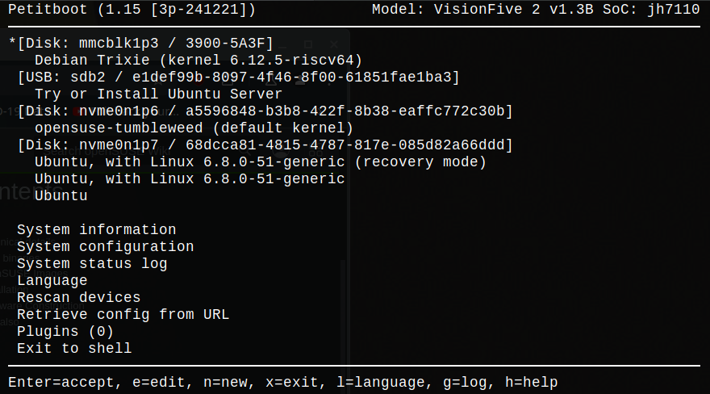

# bootdisk

__TL;DR:__
On an single board computer (SBC) or TV-box with working u-boot you can get
a versatile bootloader by replacing the default Linux initramfs with an
initramfs containing the `Petitboot` or `u-root` bootloader (provided your
default Linux kernel has `kexec`). (For download links, see below.)

__News:__
`Petitboot` built with our scripts now runs on both on ARM64 and
RISCV64, e.g. on VisionFive 2 (on UART/serial console, and on HDMI if the
kernel supports it). For both architectures the ability to boot compressed
kernels (e.g. recent Fedora) has also been added as well as an option for
remote mode (UI over telnet).

__Bootloaders with menu driven UI:__
This repo contains, mostly, information about some
[bootloaders](https://en.wikipedia.org/wiki/Bootloader) and
[bootdisks](https://en.wikipedia.org/wiki/Boot_disk) for
[SBCs](https://en.wikipedia.org/wiki/Single-board_computer) and
[TV-boxes](https://en.wikipedia.org/wiki/Digital_media_player).
With a bootdisk using one of these bootloaders you can e.g. boot many
("generic") ARM64 or RISCV64 Linux images from major distributions that have
grub boot configurations, such as Fedora, Ubuntu, Debian and openSuse.
Booting can be done without any EFI capabilities (e.g. using old u-boot) and
the bootloader offers a menu of bootable configurations found on attached media.
An example of a use case for SBCs/TV-boxes is to have a bootdisk installed on
SD and have several Linux distros installed on USBs or to choose from.
Another example of use case is to set up a bootdisk on non-removable media such
as eMMC to boot e.g. several different distros installed on different partitions
on an nvme or SATA SSD.
The term bootdisk should thus here be interpreted in a generalized sense to
mean either a bootdisk in the traditional sense or simply a dedicated boot
partition (used early in the boot chain) that holds one of these bootloaders
to act as a new intermediate stage in the boot process.

__Setting up a bootdisk:__
A bootdisk can be set up using one of the two bootloaders
[`Petitboot`](https://open-power.github.io/petitboot/)
and [`u-root`](https://u-root.org/), both of which employ a
[chainloading](https://en.wikipedia.org/wiki/Chain_loading) mechanism
utilizing the Linux [`kexec`](https://en.wikipedia.org/wiki/Kexec)
[system call](https://wiki.archlinux.org/title/Kexec).
(The repo contains two scripts for building `Petitboot` as well as
documentation, see below.)
The two bootloaders provide the same basic functionality and both are
implemented in the form of an initramfs.
`Petitboot` provides a somewhat nicer UI (cf. screenshots below) and can boot
[grub](https://wiki.archlinux.org/title/GRUB) configurations defined in
`grub.cfg`, and works for both ARM64 and RISCV64 (including `bzImage`).
On the other hand, `u-root` can boot (simple) grub configurations as well as a
subset of [syslinux](https://wiki.syslinux.org/wiki/index.php?title=SYSLINUX)
configurations,
[including](https://github.com/u-root/u-root/blob/main/pkg/boot/syslinux/syslinux.go)
the `extlinux.conf` configurations used by
[`u-boot`](https://en.wikipedia.org/wiki/Das_U-Boot).
Support for RISCV64 was recently added in `u-root`.
(The bootloader components of `u-root` are known by other names, one of them
being `Linuxboot`, but for brevity we shall refer to these components
collectively as `u-root`.)

__History:__
The bootdisk concept discussed here was originally developed as an aid for
booting on ARM64 SBCs/TV-boxes where an older resident/vendor `u-boot` was
installed that typically did not support booting using `extlinux.conf` and
therefore needed various scripts/tricks (such as `u-boot` chainloading) for
booting.
In case a `u-boot` is used which is capable of using `extlinux.conf` it is
very easy to set up a bootdisk since this essentially amounts to installing
an appropriate kernel and dtb to work with the initramfs that holds either
`Petitboot` or `u-root`.
(This is typically all that is needed on a RISCV64 box.)

__Outline of the repo:__
General info about the bootdisk concept in the script based setting for ARM64
can be found in the files [`README_petit-bootdisk.md`](README_petit-bootdisk.md)
and [`README_u-root-bootdisk.md`](README_u-root-bootdisk.md), respectively.
In the [attic](attic) area there is some more older information, such as
instructions in [`README_diy-bootdisk.md`](attic/README_diy-bootdisk.md) for
(manually) recreating or adapting bootdisks and an annotated list in
[`README_working_distros.md`](attic/README_working_distros.md) of Linux ARM64
distributions that can be installed and booted with bootdisks.

### Building Petitboot and u-root

An initramfs for `Petitboot` can be built from the C source either manually (see
e.g. [`README_diy-bootdisk.md`](attic/README_diy-bootdisk.md)) or using the
scripts [`petitboot_mkinird_riscv64.bash`](petitboot_mkinitrd_riscv64.bash) and
[`petitboot_mkinird_aarch64.bash`](petitboot_mkinitrd_aarch64.bash).
These scripts can be executed natively on an RISCV64/ARM64 host or an
RISCV64/ARM64 build host run in a QEMU emulator, see below.
An alternative is to run the scripts in a docker environment, see
[`README_docker_petitboot_mkinitrd.md`](README_docker_petitboot_mkinitrd.md).
Initramfses with `Petitboot` built using these scripts can be downloaded from
[here](https://mega.nz/folder/WclhUTpJ#jobsjgxDvph2OfXZYwyxOw) (along with setup notes).

An initramfs for `u-root` can be built from the `Go` source using a recent
version of (the toolchain) `Go` (see e.g.
[`README_diy-bootdisk.md`](attic/README_diy-bootdisk.md)).
Initramfses with `u-root` built like this can be found
[here](https://mega.nz/folder/SMt1VLSY#VTR2-eZv4jC7PH4hASp0tg).

### Linux images

Linux, e.g. Ubuntu, Debian or Devuan, can generally be installed to SBCs using
the standard installer to produce an EFI/Grub setup that can be booted with
on-board `u-boot`, at least if `u-boot` is a recent upstream/mainline version.
However, there are situations where such a version of `u-boot` is not available
(or not desirable) to install (e.g. many TV-boxes).
For these situations it is useful to have premade Linux images that can be
booted with existing `u-boot` and run-as is, only relying on `u-boot`'s ability
to do do `sysboot` via `extlinux.conf` (either directly or via chainloading of
another stage of `u-boot`).

#### RISCV64 Linux images

Linux images with Debian, Devuan or Ubuntu for RISCV64 can be created with the
script [`debuntu_dbstrap_riscv64.bash`](debuntu_dbstrap_riscv64.bash).
Images built with this script can be downloaded from
[here](https://mega.nz/folder/PAtXyRgA#SI9z7Hgz2n-S7BLk2SuM2A).

#### ARM64 Linux images

A collection of READMEs and scripts about creation of Linux images for ARM64
can be found in the [`attic`](attic/Creating_Linux_images_ARM64) area but this
information should be regarded as obsolete and will not be actively maintained.

### Image creation using QEMU

A convenient way to create an RISCV64/ARM64 Linux image is to run a native
ARM64/RISCV64 installer (e.g. in iso file format) in QEMU on e.g. an x86_64
host and install directly onto an SD/USB attached to the host.
These images will typically be EFI images and can be booted on a
SBC/TV-box using e.g. `Petitboot`/`u-root`.
A short description of how use QEMU for image creation like this
is given in [`README_QEMU_inst.md`](README_QEMU_inst.md).

### RISCV64 Linux kernel

Linux kernels for RISCV64 can be created with the script
[`riscv64_kbuild.bash`](riscv64_kbuild.bash) on an x86_64 or RISCV64 build
host.
The script produces simple gzipped tarballs with boot files (kernel image,
initramfs etc.), the module tree, header files and dtbs, for the board
manufacturers selected.
It can be used to produce the `vf2-3pole` line of kernels (for VisionFive 2)
which have `kexec()` enabled and can be used to run `Petitboot`.
Downloads of tarballs of `vf2-3pole` kernels can be found
[here](https://mega.nz/folder/jJdTCSQQ#he0JD-96HmJIQDow-QC-VQ).

### ARM64 Linux kernel

Kernels for ARM64 can be created with the script
[`arm64_kbuild.bash`](arm64_kbuild.bash) on an x86_64 or ARM64 build host.
The script produces gzipped tarballs with boot files (kernel image, initramfs
etc.), the module tree, header files and dtbs, for the board manufacturers
selected.
For instance, it can be used to produce the `3pole` line of ARM64 kernels
(which have `kexec()` enabled and can be used to run `Petitboot`/`u-root`).
These kernels are adapted for Amlogic TV-boxes but has support also for
Rockchip and Allwinner.
Downloads of the `3pole` series of kernels can be found
[here](https://mega.nz/folder/GJNjjSAY#Zru4DqCa6hyYnnkGuw02Rw).

## Screenshots

Some examples of the boot screen in `Petitboot` and `u-root`.

### Petitboot

`Petitboot` running on VisionFive 2 with serial console display (80x24 window).

*The
boot menu screen in Petitboot running on VisionFive 2 with bootable Linux images
on SD, USB and nvme.*

An older (low resolution) screenshot of `Petitboot` running on Ugoos AM6 plus
with display on HDMI screen (1366x768 resolution).

*The
boot menu screen encountered after boot with a Petitboot bootdisk.*

### u-root

An older (low resolution) screenshot of `u-root` running on Ugoos AM6 plus
with display on HDMI screen (1366x768 resolution).

*The menu
of bootable images displayed after u-root has scanned the attached devices
(here three USB sticks attached via a USB hub).*

## Disclaimer

All information here is to the best of my knowledge.
I take no responsibility for any consequences of its use, so use at your own
risk.
