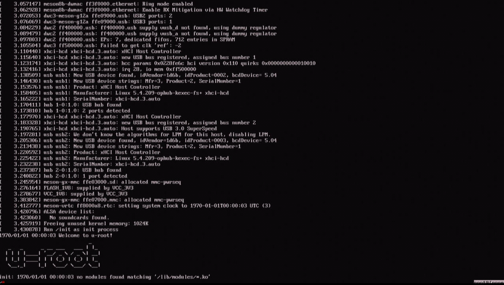
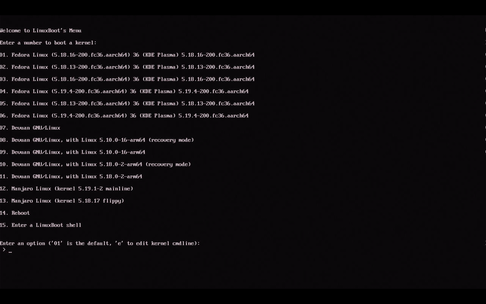
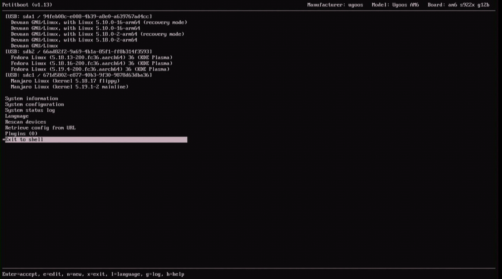

# bootdisk

This repo contains information relating to
[bootdisks](https://en.wikipedia.org/wiki/Boot_disk)
for TV-boxes/SBCs based on the ARM64 architecture.
With these bootdisks you can e.g. boot many ("generic") ARM64 Linux images with
UEFI+grub from major distributions such as Fedora 36, Ubuntu (e.g. Jammy),
Debian (e.g. Bullseye) and openSuse (Leap 15.4 and Tumbleweed).
A good use case for TV-boxes is to have the bootdisk installed on SD and have
several Linux distros installed on USBs to choose from.

All the bootdisks employ a chainloading mechanism based on the Linux
`kexec()` system call and the bootdisks come in two variants; one pair of
disks based on the `u-root` boot loader and another pair based on the
`Petitboot` boot loader. The disks are named after the chainloader.

General info about the bootdisks `u-root-bootdisk` and `petit-bootdisk` can
can be found in the README files with associated names.
The other README files contain information specific to different install
methods or distributions.
In README_working_distros.md there is a an annotated list of distributions
that can be installed and booted with the bootdisks.
Instructions for recreating/adapting the bootdisks can be found in the file
README_diy-bootdisk.md

### Making ARM64 Linux images

There is also a script `debuntu_inst.bash` that can be used to automate the
procedure of installing Ubuntu or Debian for ARM64 to a USB or SD by using
debootstrap from e.g. a running Ubuntu Server live iso image. Alternatively,
the script can produce a compressed image file. The workaround with a script
is needed for many TV-boxes/SBSc since both the Ubuntu and Debian installers
for ARM64 currently have bugs which prevent them from working correctly on
these devices.
A working Ubuntu desktop image for a TV-box can also easily be obtained by
a simple conversion procedure starting with a Raspberry Pi image, see
README_ubuntu_frompi.md.
(All these ARM64 images can be booted with the bootdisks.)

The most recent addition to these files/scripts is `ubuntu_mkimg.bash` which
is a script to produce an Ubuntu Jammy (or Focal, Kinetic) CLI image with
ophub/flippy kernel (the Ubuntu kernel can be installed after first boot).
Unlike the other files/scripts above this one can be run non natively on an
x86_64 Ubuntu machine (using qemu-aarch64-static) to generate an ARM64 image.
The generated image can be booted using any of the bootdisks but also using
`u-boot`.
Images built using this script can be found [here](https://1drv.ms/u/s!Aqo_UY80B5WOgRhJtp07M3M-EjW1?e=KwnM48).

## Screenshots

Some (low resolution) screenshots of some of the bootdisk screens.

### u-root-bootdisk and u-root-bootdisk-nc

*The screen
encountered after boot with a u-root bootdisk. If the command "boot" is entered
at the prompt (lower left corner) a scan for bootable configurations over the
attached devices is started.*

*The menu
of bootable images displayed after u-root has scanned the attached devices
(here three USB sticks attached via a USB hub).*

### petit-bootdisk and petit-bootdisk-nc

*The
boot menu screen encountered after boot with a Petitboot bootdisk.*
